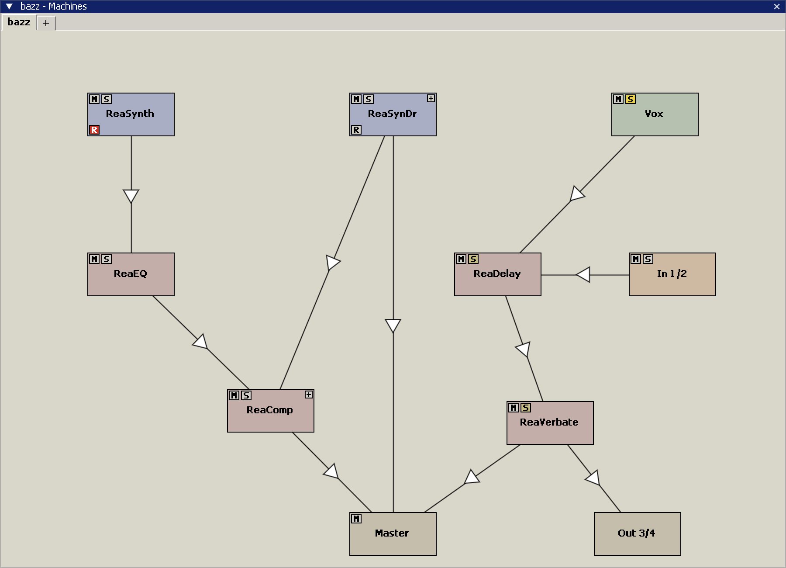
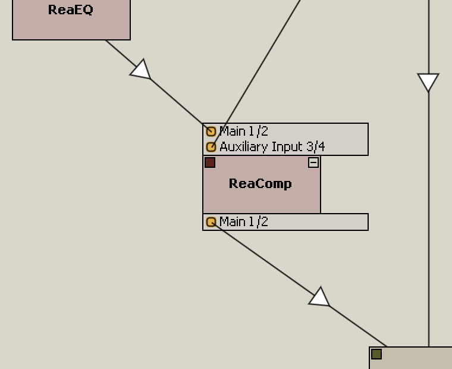
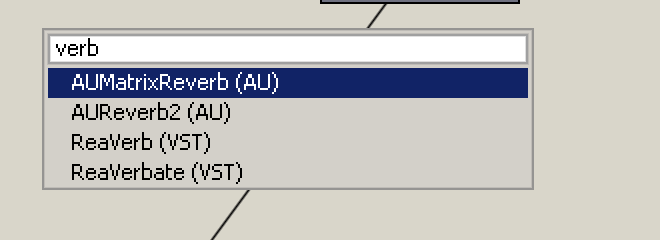

# bazz

A machine view for [REAPER](https://www.reaper.fm): build your signal flow the way classic Windows trackers did, by
dropping generators and effects on a canvas and wiring them into Master. Every box is a real REAPER track and every
wire a real send, so undo, save, plugin state and the mixer all keep working.



## What you can do

| Action | Gesture |
| --- | --- |
| Add a generator, effect, audio input or hardware output | Right-click empty canvas (type to search) |
| Move a machine | Drag it |
| Connect main out to main in | Shift-drag from one machine to another |
| Wire volume | Drag the arrow up or down |
| Insert an effect into a wire | Right-click the arrow (type to search), or drop an unconnected effect onto the wire |
| Delete a wire | Alt/Option-click its arrow, or right-click > Disconnect |
| Delete a machine | Alt/Option-click it, or right-click > Delete. Its wires are rejoined around it |
| Mute | Click the LED in the top-left corner |
| Open the plugin | Double-click the machine |
| Another graph in the same project | Click **+** in the tab strip; right-click a tab to delete its graph |
| Dock into REAPER's docker | Right-click the canvas > Dock window, or the action **bazz: Dock/undock machine view** |

Selecting a generator arms its track for live MIDI from any input, so you can play it right away.

### Extra inputs and outputs

Plugins with sidechains or multiple outputs get a small toggle in the top-right corner. It opens their ports: inputs
above the box, outputs below. Drag a cable from any output row and drop it on any input row; while you drag, the box
and the row that will receive the cable are highlighted.



### Plugin search

Right-click the canvas or a wire and start typing. Every word must appear in the plugin name, maker or type. Up/Down
to choose, Enter to add.



## How it maps to REAPER

- A folder track named `bazz` is the Master machine. Each machine is a hidden child track, so the mixer only shows
  the one folder. Every graph in a project is its own folder (`bazz`, `bazz 2`, ...).
- Wires are sends; a wire into Master is a send to the folder track. Extra plugin ports use the send's channel pairs.
- Hardware output nodes are hardware sends; audio input nodes are armed, monitored tracks that record nothing.
- Positions and panel state are stored on the tracks, so they are saved with the project.

## Install

bazz needs [ReaImGui](https://github.com/cfillion/reaimgui). Builds for macOS, Windows and Linux are on the
[Releases](https://github.com/compjuicer/bazz/releases) page.

- **ReaPack:** Extensions > ReaPack > Import repositories, paste
  `https://github.com/compjuicer/bazz/raw/main/index.xml`, then install bazz from Browse packages.
- **By hand:** put the file for your system (`reaper_bazz.dylib`, `.dll` or `.so`) in REAPER's `UserPlugins` folder
  (Options > Show REAPER resource path).

Restart REAPER and run the action **bazz: Show machine view**.

To build it yourself (macOS shown; Windows and Linux work the same with CMake):

```sh
brew install cmake ninja
cmake -S . -B build -G Ninja -DBAZZ_DEV=OFF -DCMAKE_BUILD_TYPE=Release
cmake --build build
```

## Development

The default build (`BAZZ_DEV=ON`) hot-reloads: `cmake --build build --target install_link` once, restart REAPER, then
`tools/reaper build-reload` swaps in a new core without restarting. Tests: `./build/graph_tests`. See `CLAUDE.md` for
the layout and tooling.

Releases: `tools/release <version>` writes the ReaPack `index.xml`, commits and pushes a `v<version>` tag; GitHub
Actions then builds all three platforms and attaches them to the release.

## License

MIT, see `LICENSE`. The bundled UI font is built from Wine's Tahoma replacement (GNU LGPL 2.1 or later, based on
Bitstream Vera Sans), see `vendor/fonts/README.txt`.
